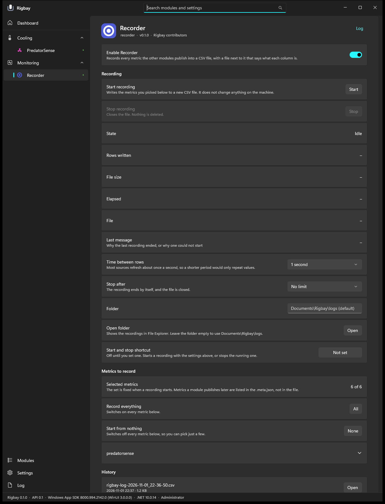

# Recorder module for Rigbay

Records every metric the other Rigbay modules publish into a CSV file, with a `.meta.json` next to it that says what each column is (id, label,
unit, source module, description), the machine, the module versions and when the recording started and ended. Module id `recorder`.

This is a module for [Rigbay](https://github.com/rigbay-app/rigbay), a Windows app that manages modules for your own machine.
Version 0.1.3 (pre-release, see [CHANGELOG.md](CHANGELOG.md) and the [releases](https://github.com/rigbay-app/module-recorder/releases)), early development. **Needs Rigbay 0.1.5 or newer** (host API 0.1.4): Rigbay 0.1.0 and 0.1.1 do not check that and would offer it, and 0.1.2 and 0.1.3 refuse it, so update Rigbay first.

**For other modules (host API 0.1.4).** `rigbay recorder status` is declared read-only. `start` and `stop` are declared as writes of the setting kind (they write files, a CSV and a `.meta.json` in the recordings folder, not hardware and not a Windows setting). `start` is previewed from its arguments and the page's settings only, never from what the bus holds, and reports `stop` as its undo when it began a recording; `stop` has no undo. The recorder publishes no metric. Not run by a plan or another module: the tests use fakes.



## What it does

- Writes the metrics bus to `Documents\Rigbay\logs\rigbay-log-<date>_<time>.csv` (folder changeable) and `<same name>.meta.json`. The recorder
  knows no other module by name: whatever publishes to the bus is recorded. It reads nothing from the machine itself, except the make, model
  and processor name for the meta file.
- Rows are one period apart exactly (1, 2, 5 or 10 s on the page, 1 to 3600 s from the command line). A value older than 30 s, or a withdrawn
  metric, is an empty cell. The columns are fixed when the recording starts; a metric that appears later is listed in the meta, not added.
- It refuses to start with less than 200 MB free on the drive and stops cleanly below 50 MB. Nothing is ever deleted or overwritten; the
  history on the page only lists the newest ten files.
- It subscribes to the bus only while it records, so an idle recorder does not make sensor modules poll faster.
- Page (Monitoring, Recorder): Start and Stop, status, period, time limit, folder, a metric picker with one switch per metric, the history.
  The dashboard bay shows `Recording 00:12:31` or `Idle`. Tray items "Start recording" and "Stop recording". An optional hotkey, off until you
  set one.

```
rigbay recorder start [--every S] [--minutes N] [--metrics a,b]
rigbay recorder status
rigbay recorder stop
```

Starting and stopping is not a change to the machine, so it asks for no approval. The format of the CSV and the meta, the timing rules and the
disk checks are in [docs/README.md](docs/README.md).

## Verified and not verified

**Verified** (2026-11-01 for 0.1.0, one machine, Windows 11, real Rigbay 0.1.0 host; build and tests again 2026-11-13 for 0.1.1, 0.1.2 and 0.1.3):

- `dotnet build` of the solution: 0 warnings, 0 errors, in a fresh `git clone --recurse-submodules`; `dotnet test`: 157 tests pass (a fake bus, a
  fake clock and a temporary folder; no hardware, no other module). The tests ran 12 times in a row without a failure in the Rigbay repository.
- **A live recording of 20 s** with the real PredatorSense module as the only source (reads only; nothing was written to the machine), started and
  stopped through the running app's verbs: 20 rows, every gap **exactly 1.000 s**, `elapsed_s` 0 to 19, six columns with their labels, no empty
  cell, no byte order mark. A row equalled what `rigbay predatorsense status` printed at the same second. The evidence is in `docs/live/`
  (`record-20s.csv`, `record-20s.meta.json`, `record-20s-verbs.txt`).
- 0.1.1 (the new page layout, Start and Stop as one button, no change to what is written or read): build and tests in a fresh clone with the submodule, see the count above. The new page was **not** looked at in the real app for this release and no recording was made with it.
- 0.1.2 (the writing loop runs on a thread of its own; two races of the page; no change to what is written or read): build and tests in a fresh clone with the submodule. One test fails on 0.1.1 and passes on 0.1.2: it holds every thread of the thread pool and then stops a recording. A live recording with the real app was **not** repeated for 0.1.2.
- A second run in which the recording was still going when the app quit was closed properly (`stop_reason: module-stopped`).
- The page and the dashboard bay were rendered and looked at in dark and light themes and in Vietnamese (`docs/live/`).

**Not verified:**

- Recordings longer than about a minute and more than 2000 rows. Nothing was run for hours.
- The disk-full paths on a real full disk (a fake free-space reading and a failing stream only).
- **XTU as a source.** The XTU module was not loaded in the live run, so the picker was seen with 6 metrics, not the roughly 30 of the two
  modules together.
- A click on a button or a toggle by a real mouse, the folder row's Apply, the "Open" and "Open folder" buttons (Explorer or Excel), the
  tray items, the hotkey, a real toast. The same code was driven by the app's script and by the verbs, and the tray and hotkey through the host
  contract in tests.
- A recording that survives a crash of the host (it flushes one row at a time, but the host was not killed on purpose).
- An installed module under `%ProgramData%\Rigbay\modules` (the live run used a folder next to the app), Windows 10, 150 % and 200 % scaling,
  high contrast, screen readers.
- The label and description from a module that supplies a description: PredatorSense supplies none, so the meta shows the label twice.

`tools/live-record.ps1` is the script of the live check. It drives the Rigbay repository's own build output and does not run from this
repository alone; it is here as the record of how the live run was made.

## Supported machines

Windows with Rigbay 0.1.2 or newer (`hostApi` `>=0.1.3 <0.2`) with the metric catalogue (`IMetricsBus.GetMetricInfo`) for labels; on a host without it the
columns are labelled with their ids. The module does not depend on any hardware. It was run only on one machine (an Acer Predator laptop,
Windows 11), with PredatorSense as the only source.

## Build

Needs Windows and the .NET SDK 8 or newer (the module targets `net8.0`). The host contract (`Rigbay.Abstractions`) comes from the git submodule
`external/rigbay` (a pinned commit of the Rigbay repository), so clone with submodules:

```powershell
git clone --recurse-submodules https://github.com/rigbay-app/module-recorder.git
cd module-recorder
dotnet build Rigbay.Recorder.slnx --configuration Release
dotnet test  Rigbay.Recorder.slnx --configuration Release
```

If you cloned without `--recurse-submodules`, run `git submodule update --init`.

The module folder is the build output: `src\Rigbay.Recorder\bin\Release\net8.0\` (`module.json`, `Rigbay.Recorder.dll`, `lang\`, the icons). It
must **not** hold `Rigbay.Abstractions.dll`; the project reference is set up so that it does not. The module has no NuGet dependency.

## Install into Rigbay

Rigbay loads modules from `%ProgramData%\Rigbay\modules\<id>\`, where the folder name must be the manifest id.

1. Copy the whole build output folder to `%ProgramData%\Rigbay\modules\recorder\`, so that
   `%ProgramData%\Rigbay\modules\recorder\module.json` exists.
2. Start Rigbay as administrator, open the module page; the first time, Rigbay lists what the module says it uses and asks you to accept it.
3. Turn the module on. It is useful next to a module that publishes metrics, such as
   [module-predatorsense](https://github.com/rigbay-app/module-predatorsense) or [module-xtu](https://github.com/rigbay-app/module-xtu).

The module declares (from `module.json`): no administrator rights of its own, no network, no services, and a read of two registry keys
(`HKLM\HARDWARE\DESCRIPTION\System\BIOS` and `...\CentralProcessor\0`) for the machine make, model and processor name in the meta file.

## Safety

The recorder writes files in your Documents folder (or the folder you choose) and nothing else; it changes no setting of the machine. It never
deletes or overwrites a file: a name that is taken gets `-2`, `-3`, and so on. Recordings hold the readings of whatever modules publish, with
the make, model and processor of the machine in the meta file; look at a file before you share it.

## License

MIT, see [LICENSE](LICENSE).
